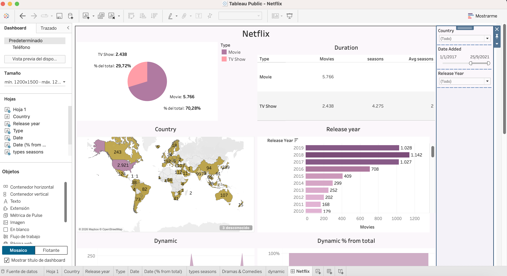

# 🎬 Netflix Content Analysis - Tableau Dashboard

🔗 **[View Interactive Dashboard on Tableau Public](https://public.tableau.com/app/profile/carlos.ramela/viz/Netflix_17900389409680/Netflix)**

## 📌 Project Overview
This interactive dashboard built in **Tableau Public** explores the global catalog of Netflix, analyzing content distribution between movies and TV shows, geographic availability, and release trends over time.

## 🎯 Key Insights
* **Content Split:** Movies dominate the platform, accounting for **70.28%** (5,766 titles), while TV Shows represent **29.72%** (2,438 titles).
* **Release Trends:** Content additions peaked between **2017 and 2019**, with 2018 recording the highest number of movie releases (1,142).
* **Global Reach:** Visualized content distribution across countries to identify top-producing markets.

## 🛠️ Tools Used
* **Tableau Public:** Interactive filtering, calculated fields (% of total), geographic mapping, and dashboard layout design.

